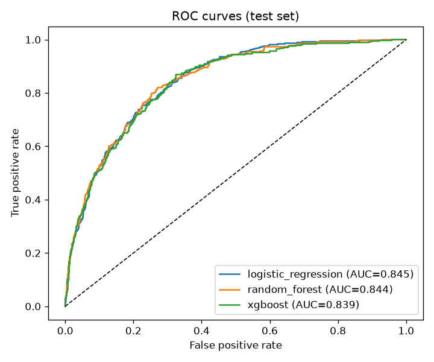
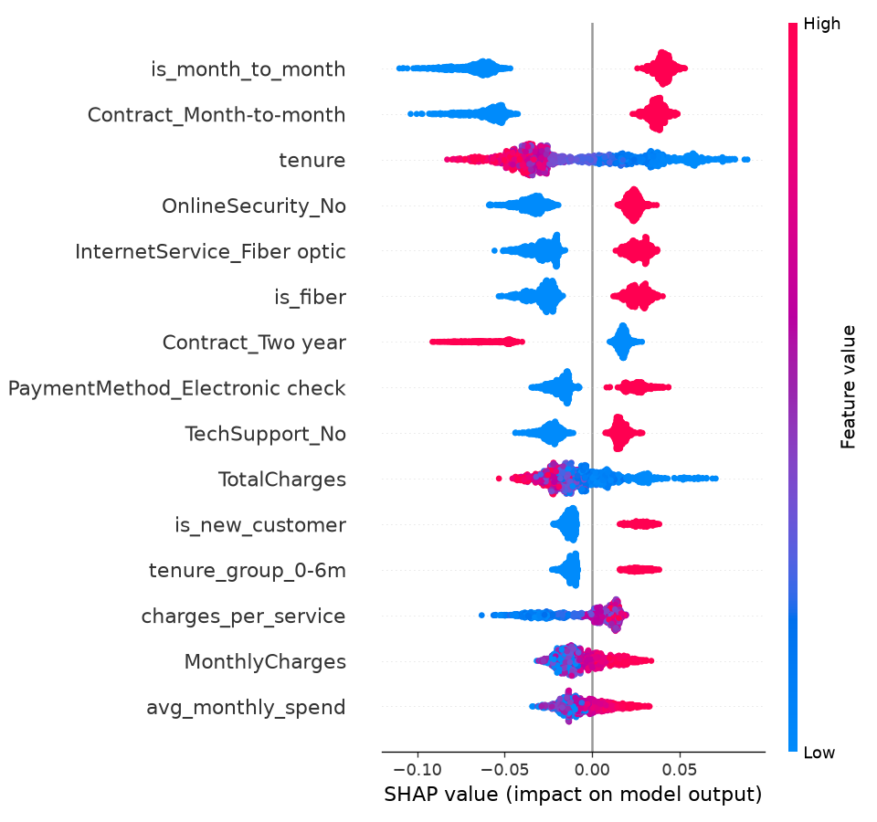

# 📉 Customer Churn Prediction - End-to-end ML project


Predict which telecom customers are about to cancel their subscription, **explain why**, and
serve the model through an **API** and a **dashboard** for the marketing team.

The project covers the full data science life cycle: data cleaning → exploratory analysis →
feature engineering → model comparison → threshold tuning → explainability (SHAP) →
REST API → Docker → automated tests and CI.

---

## 🎯 Business problem

Acquiring a new customer costs much more than keeping an existing one. The goal is to give the
retention team a **ranked list of at-risk customers** so they can target loyalty offers where
they matter most, and to understand the **main drivers of churn**.

- **Data**: [IBM Telco Customer Churn](https://github.com/IBM/telco-customer-churn-on-icp4d) - 7,043 customers, 21 columns
  (contract, services, billing, tenure…), ~26% churners.
- **Target**: `Churn` (Yes/No).
- **Baseline ("existing approach")**: a simple business rule that flags every
  *month-to-month* customer as at risk. The model must beat it.

## 🧱 Architecture

```
churn-prediction-mlops/
├── src/churn/
│   ├── config.py        # paths, columns, parameters
│   ├── data.py          # loading and cleaning (TotalCharges fix, target encoding)
│   ├── features.py      # feature engineering + sklearn preprocessing pipeline
│   ├── train.py         # CV model comparison, threshold tuning, reports
│   ├── explain.py       # SHAP global and per-customer explanations
│   └── predict.py       # inference helpers
├── api/main.py          # FastAPI service (/health, /predict, /predict/batch)
├── app/streamlit_app.py # dashboard for the marketing team
├── notebooks/01_eda.ipynb
├── tests/               # pytest: data, features, training, API
├── scripts/download_data.py
├── Dockerfile
├── Makefile
└── .github/workflows/ci.yml   # lint + tests + training + Docker build
```

## 🔬 Methodology

1. **Cleaning**: `TotalCharges` is stored as text with blanks for new customers → converted
   to numeric and set to 0 when `tenure = 0`; duplicates removed.
2. **Feature engineering** (inside the sklearn pipeline, so training and inference use the exact
   same code):
   `avg_monthly_spend`, `num_services`, `charges_per_service`, `is_month_to_month`, `is_fiber`,
   `auto_payment`, `is_new_customer`, `tenure_group`.
3. **Models compared** with 5-fold stratified cross-validation (ROC-AUC):
   Logistic Regression, Random Forest, XGBoost. Class imbalance is handled with class weights
   (`class_weight="balanced"`, `scale_pos_weight`).
4. **Model selection on cross-validation only** (no test-set leakage), then the **decision
   threshold** is tuned on out-of-fold predictions to maximise F1.
5. **Evaluation** on a held-out test set (20%): ROC-AUC, PR-AUC, precision, recall, F1,
   lift in the top 10% riskiest customers, and comparison with the business-rule baseline.
6. **Explainability** with SHAP: global drivers of churn and the top reasons for each customer.

## 📊 Results

> Run `make train`: the table below is generated automatically in
> [`reports/metrics.md`](reports/metrics.md) and the figures in `reports/figures/`.
> Copy your own numbers here after training.

| Model | CV ROC-AUC | Test ROC-AUC | Test PR-AUC |
|---|---|---|---|
| Logistic Regression | _to fill_ | _to fill_ | _to fill_ |
| Random Forest | _to fill_ | _to fill_ | _to fill_ |
| XGBoost | _to fill_ | _to fill_ | _to fill_ |

| | Precision | Recall | F1 |
|---|---|---|---|
| Best model | _to fill_ | _to fill_ | _to fill_ |
| Business rule (month-to-month) | _to fill_ | _to fill_ | _to fill_ |

<p align="center">
  
  
</p>

**Expected main churn drivers** (check them on your SHAP plot): contract type, tenure, internet service type,
payment method and monthly charges.

**Business recommendations**: target new month-to-month customers with an offer to switch to a
1-year contract, promote automatic payment, and bundle tech support / online security with
fiber subscriptions.

## 🚀 Quick start

```bash
git clone https://github.com/yousseftafoughalti1818-svg/churn-prediction-mlops.git
cd churn-prediction-mlops
python -m venv .venv && source .venv/bin/activate   # Windows: .venv\Scripts\activate
make install        # or: pip install -r requirements-dev.txt && pip install -e .
make train          # downloads the data, trains, writes reports/ and models/
make test           # runs the test suite
```

Without `make` (e.g. on Windows):

```bash
pip install -r requirements-dev.txt && pip install -e .
python scripts/download_data.py
python -m churn.train
pytest -q
uvicorn api.main:app --reload
streamlit run app/streamlit_app.py
```

### API

```bash
make api            # http://127.0.0.1:8000/docs
```

```bash
curl -X POST http://127.0.0.1:8000/predict -H "Content-Type: application/json" -d '{
  "gender": "Female", "SeniorCitizen": 0, "Partner": "No", "Dependents": "No",
  "tenure": 3, "PhoneService": "Yes", "MultipleLines": "No",
  "InternetService": "Fiber optic", "OnlineSecurity": "No", "OnlineBackup": "No",
  "DeviceProtection": "No", "TechSupport": "No", "StreamingTV": "Yes",
  "StreamingMovies": "Yes", "Contract": "Month-to-month", "PaperlessBilling": "Yes",
  "PaymentMethod": "Electronic check", "MonthlyCharges": 95.5, "TotalCharges": 280.3}'
```

Example response (values depend on your trained model):

```json
{"churn_probability": 0.81, "will_churn": true, "risk_level": "high",
 "top_drivers": [{"feature": "is_month_to_month", "impact": 0.42}, ...]}
```

### Dashboard

```bash
make app            # Streamlit: portfolio view, single-customer scoring, model performance
```

### Docker

```bash
make docker-build
make docker-run     # API on http://localhost:8000
```

## 🧪 Quality

- **Tests** (`pytest`): data cleaning, feature engineering, end-to-end training on a synthetic
  dataset with the same schema, and API contract (valid and invalid inputs).
- **CI** (GitHub Actions): lint with `ruff`, tests, training on the real dataset (metrics
  uploaded as an artifact), Docker build and container health check.

## 🛠️ Tech stack

Python · pandas · NumPy · scikit-learn · XGBoost · SHAP · Matplotlib · Seaborn ·
FastAPI · Pydantic · Streamlit · Docker · pytest · GitHub Actions

## 👤 Author

**Youssef Tafoughalti** - M2 Complex Systems Engineering (EILCO)
[LinkedIn](https://www.linkedin.com/in/youssef-tafoughalti-b1012a196/) ·
[GitHub](https://github.com/yousseftafoughalti1818-svg)
